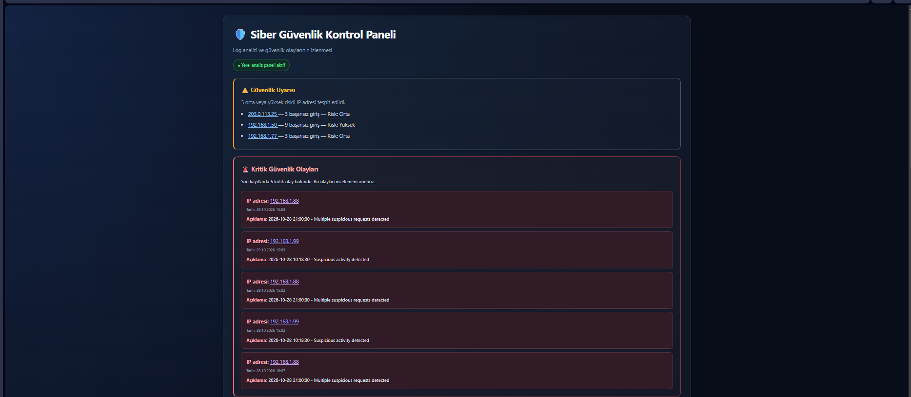
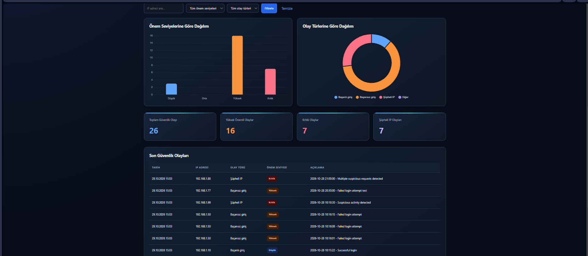
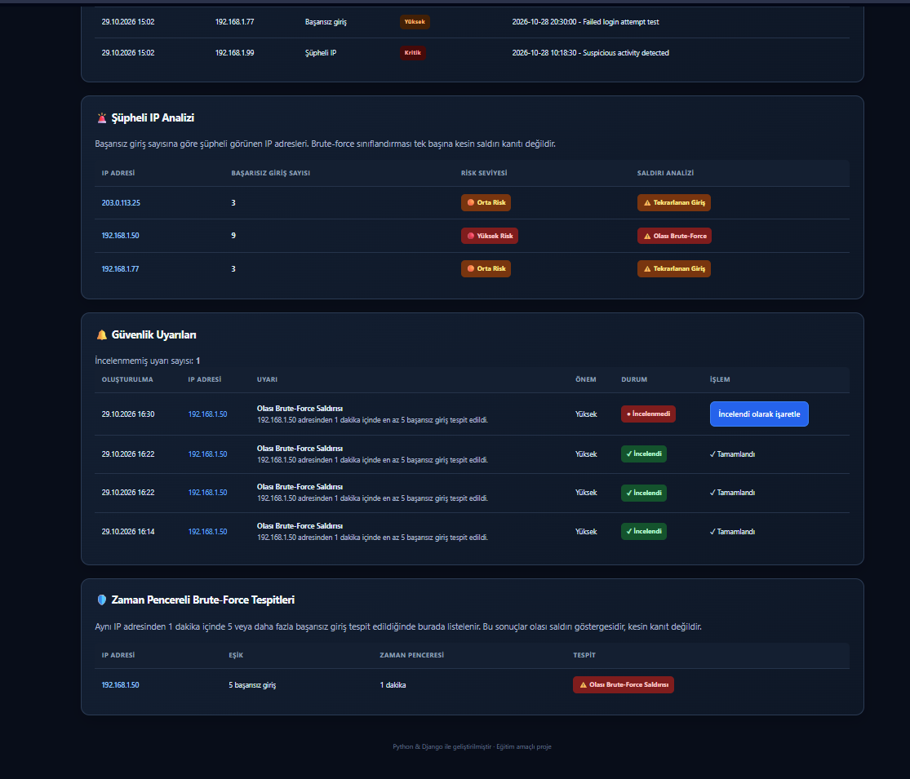
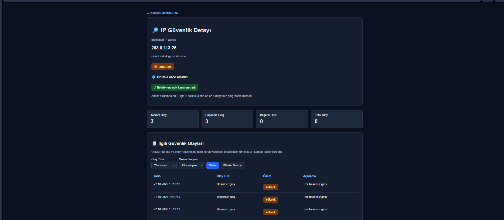
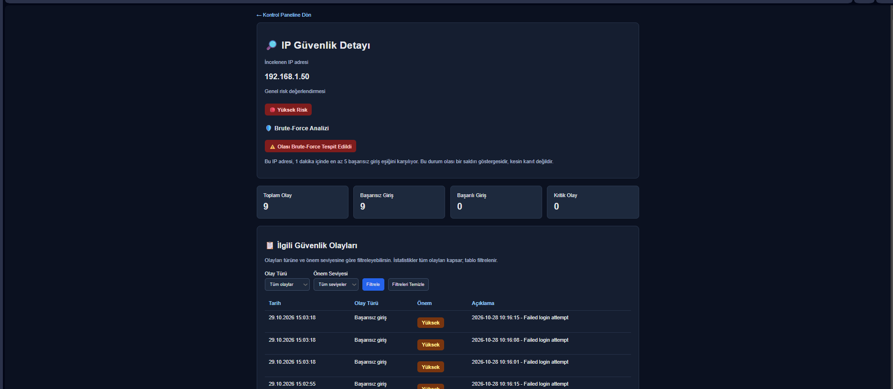
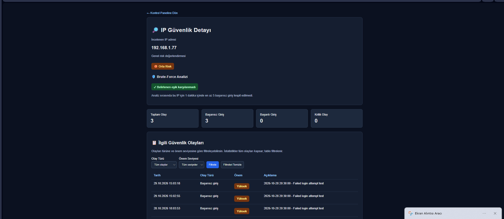

# Cybersecurity Log Analyzer

A Python and Django-based web application for analyzing security logs, detecting suspicious IP activity, identifying potential brute-force attacks, and managing security alerts.

## Features

- Security event analysis
- Suspicious IP detection
- Brute-force attack detection
- IP risk analysis
- Interactive security dashboard
- Security alert management
- JSON report export
- Log import and duplicate detection

## Technologies

- Python
- Django
- SQLite
- HTML, CSS, JavaScript
- Chart.js

## Testing

Run the tests with:

```bash
python manage.py test logs
## Screenshots

### Security Dashboard


### IP Security Details

## Proje Ekran Görüntüleri

### Siber Güvenlik Kontrol Paneli












